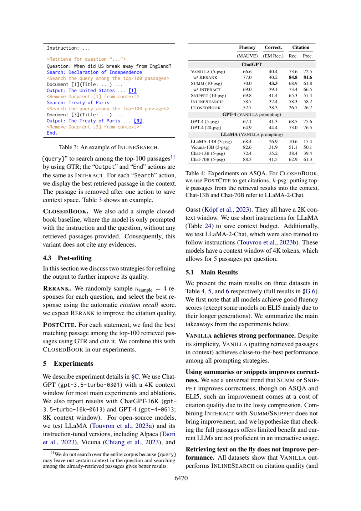
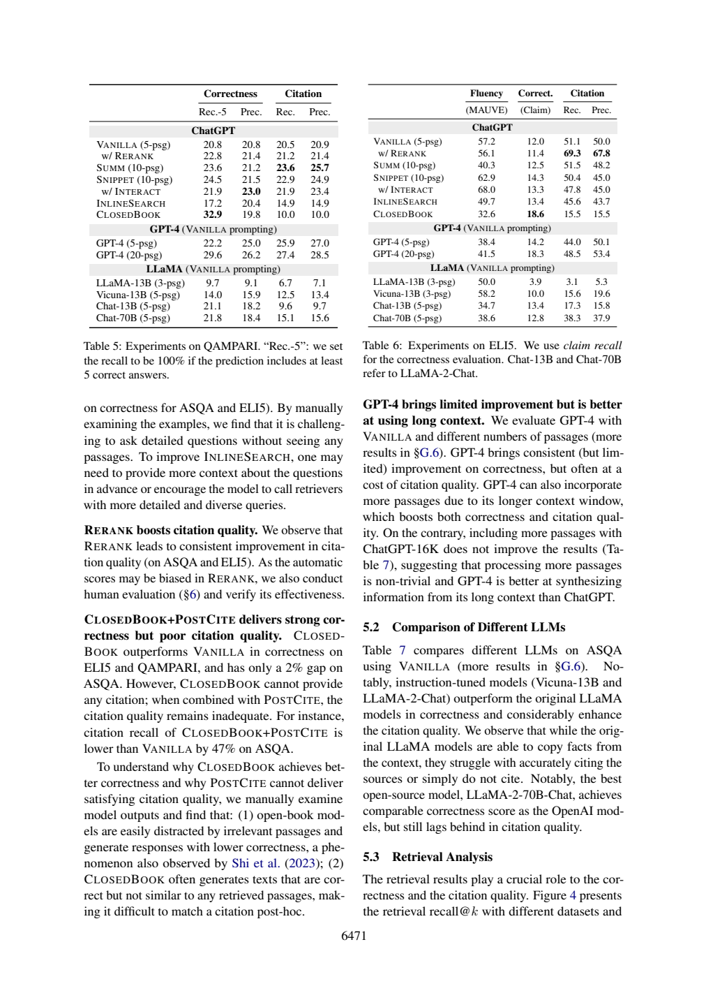

# 没看证据生成后补引用，能保证可归因吗

补上引用编号只能给出候选出处，不能保证候选文本蕴含生成句子。ALCE的CLOSED BOOK+POST CITE将生成与补引分成两阶段；它与一开始看段落的VANILLA有不同信息路径，不能把最终表差直接解释成参数知识强弱。

## 按信息流恢复方法

ALCE §4.2/4.3物理页6（6470）:22–37：CLOSED BOOK只收到instruction和question，不见检索段落；POST CITE再对每个statement，用GTR在问题检索的top100中找best matching passage并引用。初始检索见页5:46–51；Table4页6:69–71明确CLOSED BOOK行使用POST CITE。此处按所述方法理解为加引用，未报告改写生成内容的步骤，也没有给蕴含阈值。

`问题 → 无段落生成文本 → 每句在top100匹配 → 加引用`

这与`问题 → top5放入上下文 → 有段落生成并引用`不同。检索相似不等于语义蕴含；主文页4:110–122要求每句有引用且拼接引用完全支持它，才得citation recall=1。句子在世界上正确但候选池没有支持文本时，正确性与可归因性可分离；反之，来源本身错误时“有据”也不自动成为世界真值，这是方法学判断。

## 同表比较：别把跨任务趋势带进ASQA

|Table4 ASQA|MAUVE|EM Rec.|Citation Rec.|Citation Prec.|
|---|---:|---:|---:|---:|
|ChatGPT VANILLA5|66.6|40.4|73.6|72.5|
|CLOSED BOOK+POST CITE|52.7|38.3|26.7|26.7|
|后者减前者|-13.9分|-2.1百分点|-46.9百分点|-45.8百分点|

论文§5用gpt-3.5-turbo-0301，4K窗口；这些是历史模型与ASQA设置，非本次gpt-5-mini阅读调用的问答成绩。页7:34–52说CLOSED BOOK正确性高于VANILLA的任务是ELI5和QAMPARI，ASQA仍略低；人工查看提出无关段落干扰、闭卷生成与候选文本不相似两点诊断。它不是两因子独立的因果估计，亦未证明后处理唯一造成差距。




## 原答核查与可复用反例

|题|核查|
|---|---|
|D1|闭卷生成、top100匹配主链正确；又说INLINE SEARCH/INTERACT“也是top100搜”，混入另一方法。INTERACT是回查已有压缩段落对应全文，不能套Search机制。|
|D2|两行完整，四个差值与单位正确，页6:51–60及69–71覆盖表头与表注。表中原值是百分比，只有差值叫百分点。|
|D3|核心定义正确，但“除非通过NLI才等同来源蕴含”需改为“在本自动指标中得1”；NLI是代理，不能取代真实支持。把知识改写作为匹配失败机制属于解释，不是独立实验证明。|
|D4|先保留不确定性，随后却写“正确性提升可由参数记忆驱动”，没有立即限定ELI5/QAMPARI；与本题ASQA -2.1不一致。末尾限制不能自动修复主结论。|

离线例穷举“答案正确/有引用/引用蕴含”三个布尔条件，citation recall教学判据为has_citation AND entails，独立于答案正确位。蕴含值是人为赋值，不运行TRUE，也不测GTR。这帮助读者在实现前验证两个指标不能互推。

## 实际新调用与复做

本篇一次新的Bohrium CLI2.8.1原生调用，请求gpt-5-mini、photon，实际模型chenkun/gpt-5-mini。无历史工具，180秒预算，墙钟（含预检/客户端）40.784秒，usage输入6593、输出4898 tokens，completion ID见[metadata](28-run-metadata.json)。精确snapshot/seed/temperature不能锁定，逐次货币费用未知为null。未设baseline，不研究提示优劣，也不报告稳定增益、显著性或成本优势。

设计者熟悉论文，任务与来源在调用前冻结；标准不发给模型。Codex辅助非盲核查，不是独立人类评审。第27篇所需完整自动定义在调用后另补，仅用于作者核查；这暴露事前证据映射仍有缺口，不伪装为原输入充分。模型原答不改、不重答挑样本；正文表值是原论文结果，差值与算例是作者教学推导，本次模型输出只代表阅读实践，不是重跑论文实验。

本次机械结果为`ranges_valid`，15段合法定位。检查器只查JSON、D1–D4、字段存在与行范围；不判证据支持、单位、因果或题号语义对应。显式允许source_id列表在本次一个输入中可被正确使用，不可推断相对旧提示的因果增益或多seed稳定性。

离线复查：Python3标准库，无需网络或账号，将本篇文件保持同目录：

```sh
python 28-worked-example.py
python 28-validate.py 28-sources.json 28-run-output.json
```

教学例应逐字段等于[保存输出](28-worked-example-result.json)。机械校验ranges_valid退出0，其他状态退出1；随后按正文D1–D4审计逐项读[编号原文](28-numbered.txt)和[原答](28-run-output.json)。没有把结构成功写成科学回答全部正确。

重做阅读需从玻尔官方渠道安装原生CLI、登录并确认额度，使用新out目录：

```sh
python 28-replay.py --bohr /absolute/path/to/bohr --condition workflow --out fresh-run
```

脚本先dry-run逐字确认实际message，再真实调用，现有out拒绝覆盖。Windows原生exe避免.cmd多行截断，仍应遵守命令行长度限制；只对子进程移除HTTP_PROXY/HTTPS_PROXY/ALL_PROXY及小写变量，不改系统代理。UUID为非语义记录号，重跑结果不保证相同；网络失败应保留，不能伪造成功。本次6篇不同completion ID，每篇独立一次，没有并行派生代理。

## 材料导航

[任务](28-task.txt)、[核查流程](28-workflow.txt)、[标准](28-criteria.md)、[协议](28-protocol.md)、[事前哈希](28-protocol-lock.json)；哈希中的原文件名在本篇发布后加编号前缀定位，文件内容未改。[sources](28-sources.json)与编号文本是实际模型来源；[request](28-run-request.txt)、[dry-run](28-run-preflight.json)、[response](28-run-response.json)、[raw output](28-run-output.json)、metadata、stderr及[validation](28-validation.json)保留完整记录，response仅脱敏私人余额。

[来源署名与许可](28-SOURCES.md)、[原创许可](28-LICENSE.txt)。必要原页图、表头和关键数字离线齐全。本文核查是作者判断，模型原答是独立文件，不能以正文纠正覆盖原始失败。
