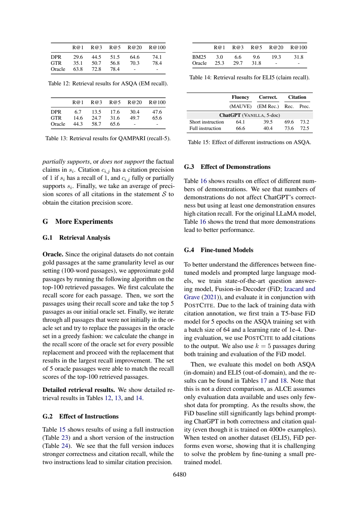

# FiD在ELI5下降，为什么不能直接证明微调无效

FiD在ELI5的较低结果支持“这个小模型、这个ASQA训练方案在域外表现有限”，不足以证明微调普遍无效。同样，ASQA与ELI5的correctness定义不同，不能把40.4到12.0当成同一指标上的迁移损失。

## 先恢复训练与比较协议

ALCE附录G.4物理页16（6480）:61–86：用ASQA训练集微调T5-base FiD，5epochs，batch64，learning rate=1e-4，4000+样本；训练和评估均k=5，评估用POST CITE补引。Tables17/18注明两模型都用top5 GTR段落。ASQA是FiD训练来源的in-domain任务，ELI5是out-of-domain任务，不能把in-domain理解为在训练样本上计算表中分数。

原文同时提醒not a direct comparison：ALCE设定只假定评估数据和few-shot提示，而FiD另外获得训练集。它们也不是同一底模开关“微调”后的对照；ChatGPT预训练细节未在此隔离，不能因FiD看过4000+样本就断言它获得了更多总训练知识。

|任务/系统|MAUVE|Correctness|Citation Rec.|Citation Prec.|
|---|---:|---:|---:|---:|
|ASQA ChatGPT|66.6|40.4 EM Rec.|73.6|72.5|
|ASQA FiD+POST CITE|75.8|28.4 EM Rec.|58.1|58.0|
|ELI5 ChatGPT|57.2|12.0 Claim Rec.|51.1|50.0|
|ELI5 FiD+POST CITE|25.2|4.4 Claim Rec.|39.3|39.3|

同任务FiD减ChatGPT三项比例差：ASQA -12.0/-15.5/-14.5个百分点，ELI5 -7.6/-11.8/-10.7个百分点。MAUVE差为+9.2/-32.0分。这些是论文表值的教学算术，非本次训练结果；也不能凭两个任务差值比大小断言迁移使差距缩小。EM短答案命中与生成答案蕴含子断言是不同事件，页17两表实际表头分别EM Rec.与Claim。




## 原答核查

|题|核查|
|---|---|
|D1|超参、k与POST CITE正确；“为避免过拟合选择这些超参”无原文支持，是模型自行补的动机。|
|D2|16个值与6个差值正确，却称Table18“表头同上”并沿用EM；真实是Claim，妨碍跨域正确理解。ASQA引用从页17:10开始，漏了8–9行表头，需8–13完整核对。|
|D3|not direct comparison解释方向正确；把in-domain说成“在FiD训练所用的ASQA数据上评测”易被理解为训练样本评测，需明确同任务分布而非同样本。把跨任务数值下降当域转移影响也混入指标变化。|
|D4|正确拒绝所有微调/所有域迁移必败，但模型规模与预训练不是在这里受控隔离的原因，仅是潜在混杂。|

离线检查卡在每个数值旁保存dataset/metric/model/protocol。代码允许同任务同指标的两系统相减，拒绝ASQA EM与ELI5 Claim的直接差分。这个拒绝是教学规则，不是新的显著性检验。要研究微调因果，应另做同底模、同数据权限、同评估定义的受控设计；本篇没有执行该训练。

## 实际新调用与复做

本篇一次新的Bohrium CLI2.8.1原生调用，请求gpt-5-mini、photon，实际模型chenkun/gpt-5-mini。无历史工具，180秒预算，墙钟（含预检/客户端）36.768秒，usage输入5068、输出5211 tokens，completion ID见[metadata](29-run-metadata.json)。精确snapshot/seed/temperature不能锁定，逐次货币费用未知为null。未设baseline，不研究提示优劣，也不报告稳定增益、显著性或成本优势。

设计者熟悉论文，任务与来源在调用前冻结；标准不发给模型。Codex辅助非盲核查，不是独立人类评审。第27篇所需完整自动定义在调用后另补，仅用于作者核查；这暴露事前证据映射仍有缺口，不伪装为原输入充分。模型原答不改、不重答挑样本；正文表值是原论文结果，差值与算例是作者教学推导，本次模型输出只代表阅读实践，不是重跑论文实验。

本次机械结果为`ranges_valid`，10段合法定位。检查器只查JSON、D1–D4、字段存在与行范围；不判证据支持、单位、因果或题号语义对应。显式允许source_id列表在本次一个输入中可被正确使用，不可推断相对旧提示的因果增益或多seed稳定性。

离线复查：Python3标准库，无需网络或账号，将本篇文件保持同目录：

```sh
python 29-worked-example.py
python 29-validate.py 29-sources.json 29-run-output.json
```

教学例应逐字段等于[保存输出](29-worked-example-result.json)。机械校验ranges_valid退出0，其他状态退出1；随后按正文D1–D4审计逐项读[编号原文](29-numbered.txt)和[原答](29-run-output.json)。没有把结构成功写成科学回答全部正确。

重做阅读需从玻尔官方渠道安装原生CLI、登录并确认额度，使用新out目录：

```sh
python 29-replay.py --bohr /absolute/path/to/bohr --condition workflow --out fresh-run
```

脚本先dry-run逐字确认实际message，再真实调用，现有out拒绝覆盖。Windows原生exe避免.cmd多行截断，仍应遵守命令行长度限制；只对子进程移除HTTP_PROXY/HTTPS_PROXY/ALL_PROXY及小写变量，不改系统代理。UUID为非语义记录号，重跑结果不保证相同；网络失败应保留，不能伪造成功。本次6篇不同completion ID，每篇独立一次，没有并行派生代理。

## 材料导航

[任务](29-task.txt)、[核查流程](29-workflow.txt)、[标准](29-criteria.md)、[协议](29-protocol.md)、[事前哈希](29-protocol-lock.json)；哈希中的原文件名在本篇发布后加编号前缀定位，文件内容未改。[sources](29-sources.json)与编号文本是实际模型来源；[request](29-run-request.txt)、[dry-run](29-run-preflight.json)、[response](29-run-response.json)、[raw output](29-run-output.json)、metadata、stderr及[validation](29-validation.json)保留完整记录，response仅脱敏私人余额。

[来源署名与许可](29-SOURCES.md)、[原创许可](29-LICENSE.txt)。必要原页图、表头和关键数字离线齐全。本文核查是作者判断，模型原答是独立文件，不能以正文纠正覆盖原始失败。
