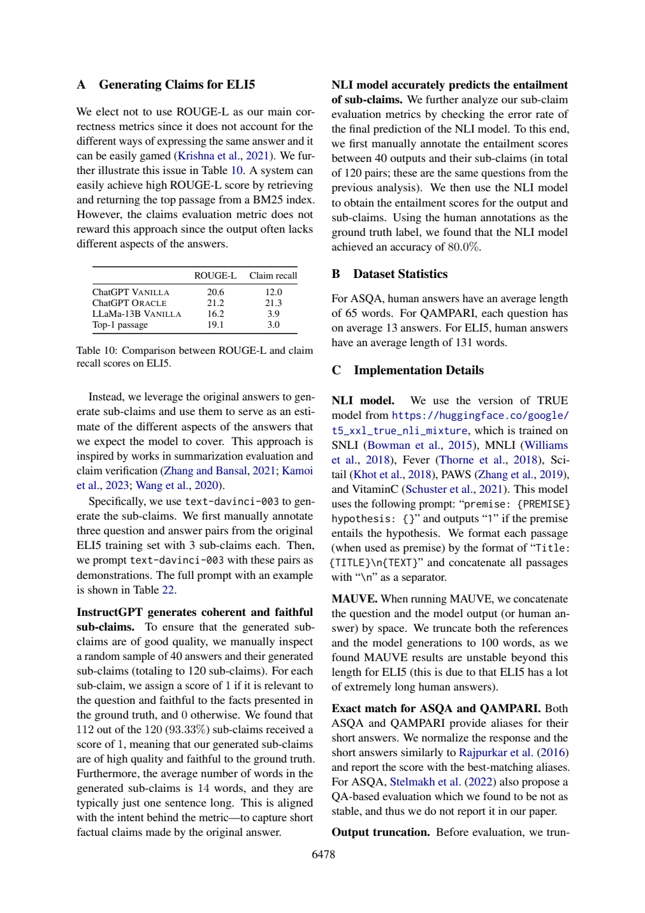

# ROUGE-L接近，为什么ELI5答案覆盖差很多

ELI5 Table10中ROUGE-L相近的系统，claim recall可以相差很大。相近分数或一致的局部排序都不能证明完整可靠：相对排序会掩盖覆盖量的差距。本篇将表值、蕴含方向和验证样本分开读取。

## 同排序不等于同覆盖

ALCE附录A物理页14（6478）Table10：

|系统|ROUGE-L|Claim recall|
|---|---:|---:|
|ChatGPT VANILLA|20.6|12.0|
|ChatGPT ORACLE|21.2|21.3|
|LLaMA-13B VANILLA|16.2|3.9|
|Top-1 passage|19.1|3.0|

注意实际排序并非完全一致：ROUGE-L把Top1排在LLaMA前，claim recall反过来。这提供一个直接反例；即使在一个排序一致的子集上，也无法证明绝对质量。ORACLE减VANILLA为ROUGE-L +0.6分、claim recall +9.3个百分点；Top1减VANILLA为-1.5分/-9.0个百分点。ROUGE-L是重叠指标分数，使用“分”避免把两种量尺混作同一覆盖比例，不能直接比较9.3与0.6来证明相同意义的增益倍数。

页14:2–11解释只返回BM25首段可得较高ROUGE-L，却缺不同方面。Claim recall的方向见页4:37–55：以模型完整输出为premise，检查其是否蕴含三条预设subclaims。这与citation recall的“来源文本→输出句子”方向不同。覆盖预设事实也不检查答案额外的错误主张，更非开放问题所有正确答案的完备性证明。

## 验证链不是完整真值认证

附录A先从ELI5训练集手标3个问答对、每对3claims作为示例，再用text-davinci-003生成。抽检40答案、120claims，112条同时相关且忠实，93.33%；平均14 **words**，不是14汉字。另以同问题的40个输出/120蕴含对作NLI人工gold检验，accuracy80.0%。93.33%针对claims质量，80%针对蕴含分类，不能替代claim recall的系统分数，更不能直接相乘推断联合可靠率。



## 原答核查

|题|核查|
|---|---|
|D1|四行与差值正确，把两列单位统称“百分比点”不精确；又直接比较两个量尺的改善幅度，不能据此建立共同效应大小。|
|D2|正确说明输出蕴含claims；ROUGE-L最长公共子序列是通用定义解释，本文未重跑实现。|
|D3|112/120和80%读对，但把14words说成“14字”，并将两层说成“同一120对”，应保留同问题、不同标注对象的区别。|
|D4|正确拒绝“排序一致足以证明可靠”，未指出Table10本身Top1与LLaMA排序相反；其关于开放覆盖限制是方法学判断，不能当新人工实验。|

离线算例实际计算两种排序、Top1/LLaMA的反转，以及两组表值差；不调用NLI、BM25或新问答模型。检查卡是“分数→事件→方向→遗漏维度→反例”，方便在别的评测表中重用。

## 实际新调用与复做

本篇一次新的Bohrium CLI2.8.1原生调用，请求gpt-5-mini、photon，实际模型chenkun/gpt-5-mini。无历史工具，180秒预算，墙钟（含预检/客户端）36.561秒，usage输入4667、输出4244 tokens，completion ID见[metadata](30-run-metadata.json)。精确snapshot/seed/temperature不能锁定，逐次货币费用未知为null。未设baseline，不研究提示优劣，也不报告稳定增益、显著性或成本优势。

设计者熟悉论文，任务与来源在调用前冻结；标准不发给模型。Codex辅助非盲核查，不是独立人类评审。第27篇所需完整自动定义在调用后另补，仅用于作者核查；这暴露事前证据映射仍有缺口，不伪装为原输入充分。模型原答不改、不重答挑样本；正文表值是原论文结果，差值与算例是作者教学推导，本次模型输出只代表阅读实践，不是重跑论文实验。

本次机械结果为`ranges_valid`，12段合法定位。检查器只查JSON、D1–D4、字段存在与行范围；不判证据支持、单位、因果或题号语义对应。显式允许source_id列表在本次一个输入中可被正确使用，不可推断相对旧提示的因果增益或多seed稳定性。

离线复查：Python3标准库，无需网络或账号，将本篇文件保持同目录：

```sh
python 30-worked-example.py
python 30-validate.py 30-sources.json 30-run-output.json
```

教学例应逐字段等于[保存输出](30-worked-example-result.json)。机械校验ranges_valid退出0，其他状态退出1；随后按正文D1–D4审计逐项读[编号原文](30-numbered.txt)和[原答](30-run-output.json)。没有把结构成功写成科学回答全部正确。

重做阅读需从玻尔官方渠道安装原生CLI、登录并确认额度，使用新out目录：

```sh
python 30-replay.py --bohr /absolute/path/to/bohr --condition workflow --out fresh-run
```

脚本先dry-run逐字确认实际message，再真实调用，现有out拒绝覆盖。Windows原生exe避免.cmd多行截断，仍应遵守命令行长度限制；只对子进程移除HTTP_PROXY/HTTPS_PROXY/ALL_PROXY及小写变量，不改系统代理。UUID为非语义记录号，重跑结果不保证相同；网络失败应保留，不能伪造成功。本次6篇不同completion ID，每篇独立一次，没有并行派生代理。

## 材料导航

[任务](30-task.txt)、[核查流程](30-workflow.txt)、[标准](30-criteria.md)、[协议](30-protocol.md)、[事前哈希](30-protocol-lock.json)；哈希中的原文件名在本篇发布后加编号前缀定位，文件内容未改。[sources](30-sources.json)与编号文本是实际模型来源；[request](30-run-request.txt)、[dry-run](30-run-preflight.json)、[response](30-run-response.json)、[raw output](30-run-output.json)、metadata、stderr及[validation](30-validation.json)保留完整记录，response仅脱敏私人余额。

[来源署名与许可](30-SOURCES.md)、[原创许可](30-LICENSE.txt)。必要原页图、表头和关键数字离线齐全。本文核查是作者判断，模型原答是独立文件，不能以正文纠正覆盖原始失败。
