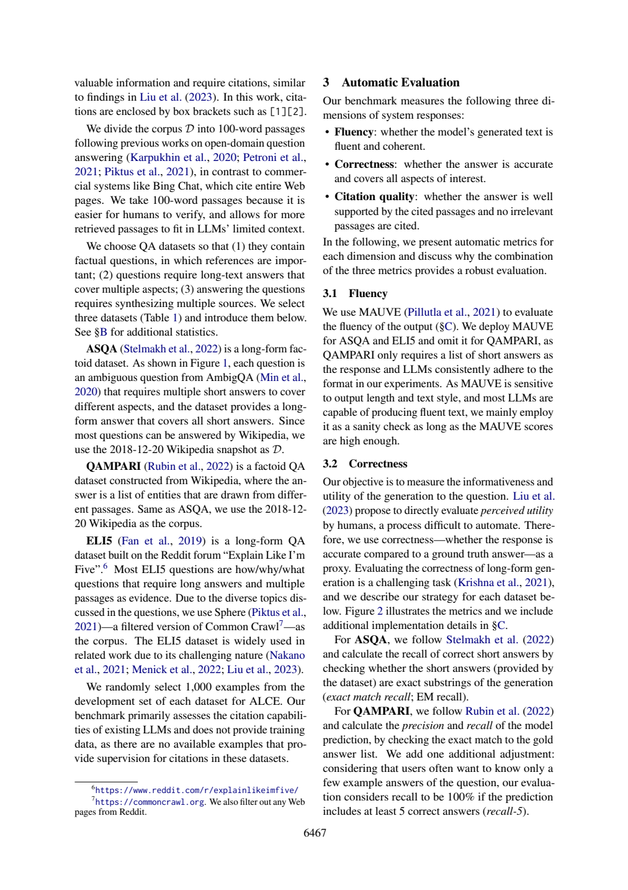

# 一条引用到底指什么：100词片段与数据来源边界

ALCE的一个citation指向100-word片段，不是整网页，也不是100 tokens。这个粒度让人工核验更容易，也让有限窗口容纳更多段落；它不保证证据完整性或实时性。任务、语料快照、引用粒度和模型窗口需要分别记录。

## 用一张来源表防止串库

ALCE物理页3（6467）:4–50给出粒度、数据集和评测抽样：

|数据集|任务形态|检索语料|附录B平均统计|
|---|---|---|---|
|ASQA|歧义事实问题，多个短答案合成长答|2018-12-20 Wikipedia|人答65 words|
|QAMPARI|从不同段落收集实体列表|2018-12-20 Wikipedia|每题13答案|
|ELI5|how/why/what长解释，多段证据|Sphere，过滤的Common Crawl，并排除Reddit页|人答131 words|

平均统计来自物理页14:61–65，不是这次调用的输出长度。每数据集从development set随机取1000例；ALCE不提供citation supervision训练数据，不能读成原始数据集没有训练集或所有实验都不允许使用ASQA训练数据。

语料中的100-word passage、窗口2K/4K tokens和实际k段数是不同单位。页5:64–77说4K窗口安全容纳5段，summary/snippet平均压缩6倍能容纳更多段；这不是把100word切片“修复”为完整网页。脚注10的ChatGPT relevance过滤仅属于SUMM/SNIPPET流程，不能套成所有数据集语料构建规则。

## 为什么支持不是完整覆盖或实时真值

一个答案若只覆盖一个方面，即使所写每句有据，也仍可能漏掉问题其他方面；即使来源支持，旧快照中的陈述也不必等于今天事实。这两点是作者的逻辑判断，未做新实时核验或整页/片段A/B。片段切分可能跨断句，是待核查风险；不能用summary/snippet的lossy原文直接充当“100word切分必定丢失信息”的实测证据。



## 原答核查

|题|核查|
|---|---|
|D1|100word与两点动机读对；误将summary/snippet说成弥补切片信息丢失，它们实际为压缩以容纳更多段，自身也lossy。未正面完整解释word/token差别。|
|D2|三种语料归属正确，保留Reddit过滤；但evidence遗漏ASQA任务18–26等关键行，把49–50通用脚注作为过滤证据需要核其上下文，并避免将SUMM过滤扩成通用规则。|
|D3|1000/65/13/131数值正确；先写65/131“字”，后写words，单位自相矛盾，应统一英文词。page14:61–65范围合法且覆盖统计。|
|D4|结论方向合理，但没有直接解释旧快照导致时效边界，而以检索/窗口/NLI证明实时性，证据链不足；“原文支持实时世界真值结论”过强。这一结论应明确标为本篇方法学推论。|

离线检查器将passage_unit设为words、context_unit设为tokens，断言ELI5语料不是Wikipedia，各评测样本为1000，并将错误配置“100 tokens、ELI5=Wikipedia”拒绝。它检查元数据一致性，不模拟真实切分或tokenizer；word/token换算依赖文本与模型，不能用固定倍数冒充测量。

## 实际新调用与复做

本篇一次新的Bohrium CLI2.8.1原生调用，请求gpt-5-mini、photon，实际模型chenkun/gpt-5-mini。无历史工具，180秒预算，墙钟（含预检/客户端）46.368秒，usage输入5720、输出6396 tokens，completion ID见[metadata](31-run-metadata.json)。精确snapshot/seed/temperature不能锁定，逐次货币费用未知为null。未设baseline，不研究提示优劣，也不报告稳定增益、显著性或成本优势。

设计者熟悉论文，任务与来源在调用前冻结；标准不发给模型。Codex辅助非盲核查，不是独立人类评审。第27篇所需完整自动定义在调用后另补，仅用于作者核查；这暴露事前证据映射仍有缺口，不伪装为原输入充分。模型原答不改、不重答挑样本；正文表值是原论文结果，差值与算例是作者教学推导，本次模型输出只代表阅读实践，不是重跑论文实验。

本次机械结果为`ranges_valid`，19段合法定位。检查器只查JSON、D1–D4、字段存在与行范围；不判证据支持、单位、因果或题号语义对应。显式允许source_id列表在本次一个输入中可被正确使用，不可推断相对旧提示的因果增益或多seed稳定性。

离线复查：Python3标准库，无需网络或账号，将本篇文件保持同目录：

```sh
python 31-worked-example.py
python 31-validate.py 31-sources.json 31-run-output.json
```

教学例应逐字段等于[保存输出](31-worked-example-result.json)。机械校验ranges_valid退出0，其他状态退出1；随后按正文D1–D4审计逐项读[编号原文](31-numbered.txt)和[原答](31-run-output.json)。没有把结构成功写成科学回答全部正确。

重做阅读需从玻尔官方渠道安装原生CLI、登录并确认额度，使用新out目录：

```sh
python 31-replay.py --bohr /absolute/path/to/bohr --condition workflow --out fresh-run
```

脚本先dry-run逐字确认实际message，再真实调用，现有out拒绝覆盖。Windows原生exe避免.cmd多行截断，仍应遵守命令行长度限制；只对子进程移除HTTP_PROXY/HTTPS_PROXY/ALL_PROXY及小写变量，不改系统代理。UUID为非语义记录号，重跑结果不保证相同；网络失败应保留，不能伪造成功。本次6篇不同completion ID，每篇独立一次，没有并行派生代理。

## 材料导航

[任务](31-task.txt)、[核查流程](31-workflow.txt)、[标准](31-criteria.md)、[协议](31-protocol.md)、[事前哈希](31-protocol-lock.json)；哈希中的原文件名在本篇发布后加编号前缀定位，文件内容未改。[sources](31-sources.json)与编号文本是实际模型来源；[request](31-run-request.txt)、[dry-run](31-run-preflight.json)、[response](31-run-response.json)、[raw output](31-run-output.json)、metadata、stderr及[validation](31-validation.json)保留完整记录，response仅脱敏私人余额。

[来源署名与许可](31-SOURCES.md)、[原创许可](31-LICENSE.txt)。必要原页图、表头和关键数字离线齐全。本文核查是作者判断，模型原答是独立文件，不能以正文纠正覆盖原始失败。
