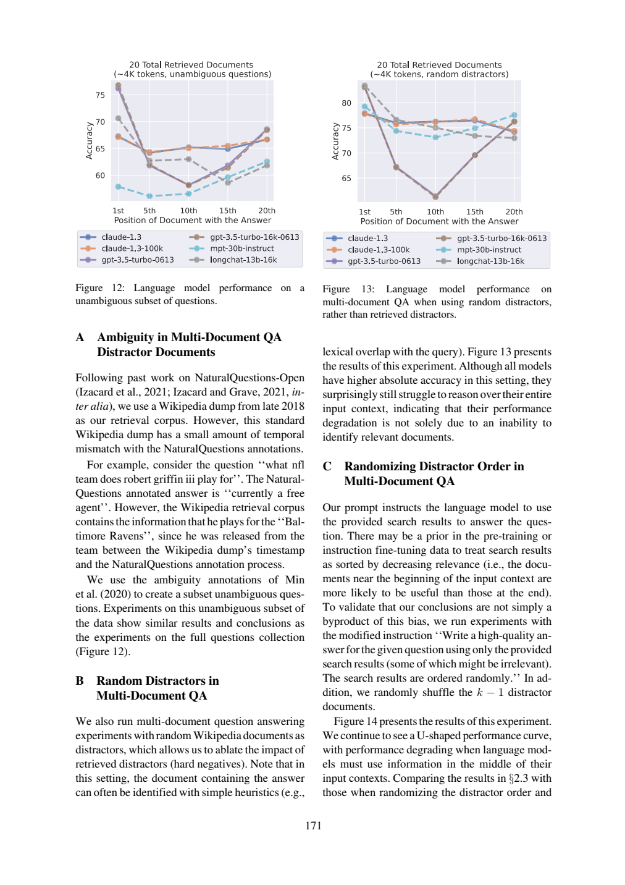
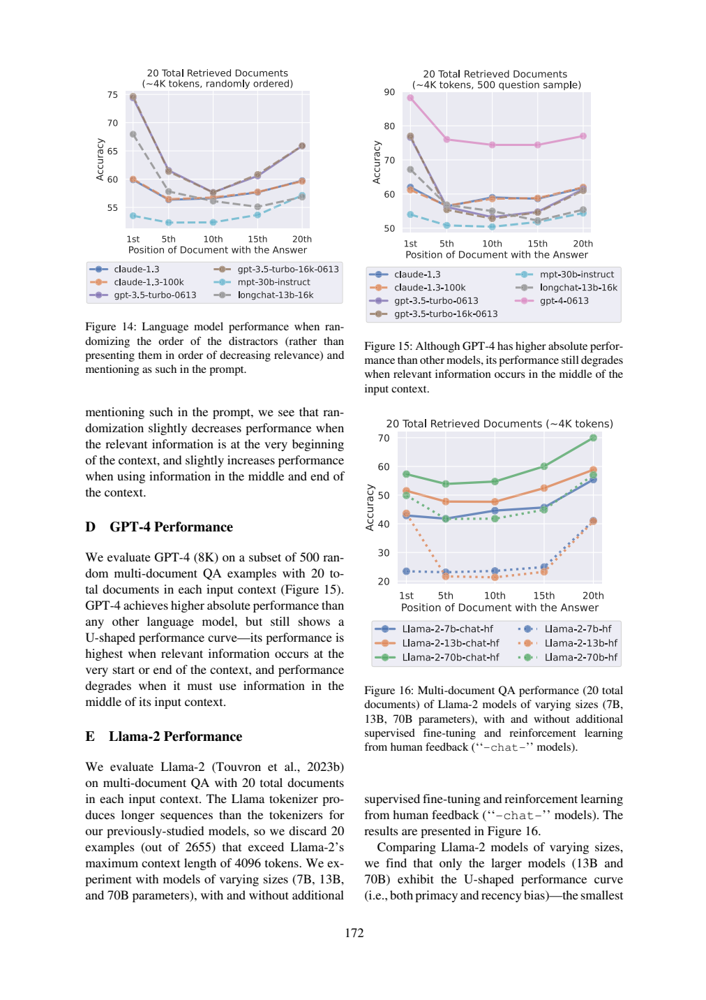

# 随机干扰文档实验，排除了哪些解释

随机干扰文档提高绝对准确率，却没有让模型在整个上下文上稳定取用信息；明确“随机排序”并打乱顺序后仍有U形。三项补充实验削弱了若干单一解释，但没有识别唯一机制，也没有解决位置问题。

## 三项检验分别改变了什么

《Lost in the Middle》物理页15（印刷171）附录A：late2018 Wikipedia与NaturalQuestions标注存在时间错配。Robert Griffin III问题，标注是currently a free agent，语料仍写Baltimore Ravens；不能把语料中另一个合理时间点的答案简单当无关噪声。作者用Min等歧义标注构造无歧义子集，Figure12结果与全题集合相似。这是子集稳健性检查，不是修复所有快照或证明歧义贡献为零。

|检验|改变|观察|能支持的边界|
|---|---|---|---|
|A无歧义子集|问题集合|结果/结论相似|少量歧义不是全部解释|
|B随机干扰|用随机Wiki替换检索hard negatives|所有测试模型绝对accuracy更高，仍不能稳健覆盖全上下文|问题不只在识别相关文档|
|C随机顺序|指令明示随机，并shuffle k−1干扰文档|仍U形；开头略降、中后略升|该组合没有消除位置效应，不能分离提示与顺序贡献|

B原文在页15:25–42，C在43–67续页16:1–10。B中的random documents与C中的random order是不同干预，不能用Figure14首尾变化解释Figure13提高幅度。相关文档位置仍是扫描变量，C不是把所有位置随机成一个混合分数。




## 原答核查

|题|核查|
|---|---|
|D1|读对无歧义子集结论，却漏了题目要求的Griffin时间错配具体例子，也没完整区分标注与合理答案；所引19–24不含5–18的例子。把“不是主要原因”说得过强，原文只能支持观察不完全由该因素造成。|
|D2|随机文档和绝对accuracy方向正确，随后用页16 Figure14来解释B，这是把随机文档与随机顺序混淆。|
|D3|正确恢复两项联合改变及不能拆分贡献；“以消除排序先验”过满，实验改变线索不代表先验已不存在，宜说检验其解释充分性。|
|D4|拒绝唯一成因/彻底解决方向正确，但又说A不是主要原因，仍超出无效应幅度估计支持。其证据含GPT4图，也不能替代三项检验各自证据。|

## 可复用的因果核查卡

每个消融先列“变了什么、保持什么、观察什么、排除到什么程度”。C若要拆分提示与顺序，下一步可做2×2设计：原提示/随机提示 × 相关度序/随机序。离线脚本只列这四格与本篇已观察的组合标记，缺格仍缺；不编造三个未运行格的accuracy。这个2×2是未来设计建议，不是论文已做或本次已跑的GPU实验。

## 实际新调用与复做

本篇一次新的Bohrium CLI2.8.1原生调用，请求gpt-5-mini、photon，实际模型chenkun/gpt-5-mini。无历史工具，180秒预算，墙钟（含预检/客户端）42.321秒，usage输入3783、输出5288 tokens，completion ID见[metadata](32-run-metadata.json)。精确snapshot/seed/temperature不能锁定，逐次货币费用未知为null。未设baseline，不研究提示优劣，也不报告稳定增益、显著性或成本优势。

设计者熟悉论文，任务与来源在调用前冻结；标准不发给模型。Codex辅助非盲核查，不是独立人类评审。第27篇所需完整自动定义在调用后另补，仅用于作者核查；这暴露事前证据映射仍有缺口，不伪装为原输入充分。模型原答不改、不重答挑样本；正文表值是原论文结果，差值与算例是作者教学推导，本次模型输出只代表阅读实践，不是重跑论文实验。

本次机械结果为`ranges_valid`，14段合法定位。检查器只查JSON、D1–D4、字段存在与行范围；不判证据支持、单位、因果或题号语义对应。显式允许source_id列表在本次一个输入中可被正确使用，不可推断相对旧提示的因果增益或多seed稳定性。

离线复查：Python3标准库，无需网络或账号，将本篇文件保持同目录：

```sh
python 32-worked-example.py
python 32-validate.py 32-sources.json 32-run-output.json
```

教学例应逐字段等于[保存输出](32-worked-example-result.json)。机械校验ranges_valid退出0，其他状态退出1；随后按正文D1–D4审计逐项读[编号原文](32-numbered.txt)和[原答](32-run-output.json)。没有把结构成功写成科学回答全部正确。

重做阅读需从玻尔官方渠道安装原生CLI、登录并确认额度，使用新out目录：

```sh
python 32-replay.py --bohr /absolute/path/to/bohr --condition workflow --out fresh-run
```

脚本先dry-run逐字确认实际message，再真实调用，现有out拒绝覆盖。Windows原生exe避免.cmd多行截断，仍应遵守命令行长度限制；只对子进程移除HTTP_PROXY/HTTPS_PROXY/ALL_PROXY及小写变量，不改系统代理。UUID为非语义记录号，重跑结果不保证相同；网络失败应保留，不能伪造成功。本次6篇不同completion ID，每篇独立一次，没有并行派生代理。

## 材料导航

[任务](32-task.txt)、[核查流程](32-workflow.txt)、[标准](32-criteria.md)、[协议](32-protocol.md)、[事前哈希](32-protocol-lock.json)；哈希中的原文件名在本篇发布后加编号前缀定位，文件内容未改。[sources](32-sources.json)与编号文本是实际模型来源；[request](32-run-request.txt)、[dry-run](32-run-preflight.json)、[response](32-run-response.json)、[raw output](32-run-output.json)、metadata、stderr及[validation](32-validation.json)保留完整记录，response仅脱敏私人余额。

[来源署名与许可](32-SOURCES.md)、[原创许可](32-LICENSE.txt)。必要原页图、表头和关键数字离线齐全。本文核查是作者判断，模型原答是独立文件，不能以正文纠正覆盖原始失败。
