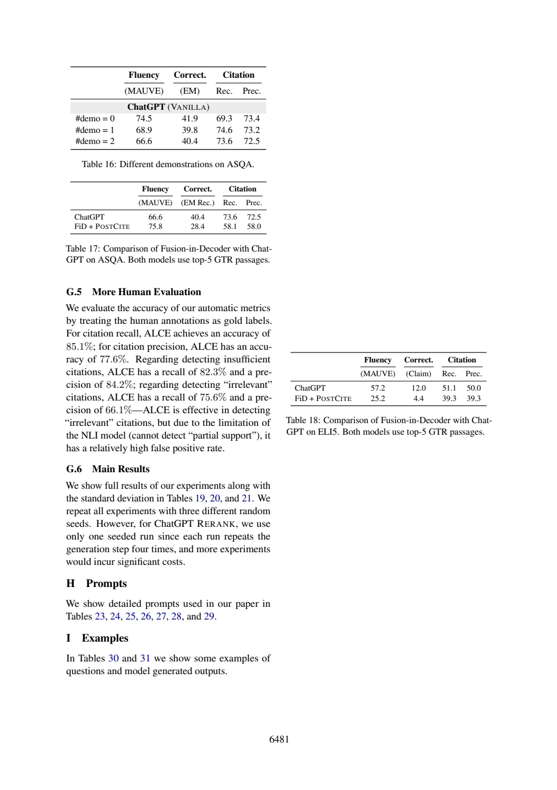

# 检测无关引用的precision，为什么不是citation precision

检测器的precision分母是“被判为错误的项目”，citation precision分母是“被生成答案使用的引用”。把66.1%误读为答案引用质量，会把评估器性能与被评估对象混成同一层。本篇用ALCE附录G.5的一次新阅读，展示即使JSON与定位都合法，模型仍会把正类方向解释反。

## 先固定事件和分母

ALCE物理页17（印刷6481）G.5，以人工标注作gold，报告两种自动判断的accuracy为85.1%（citation recall）和77.6%（citation precision）。它们是评估器相对人工判断的正确比例，不是被生成答案的引用得分。

|检测目标（正类）|检测recall|检测precision|
|---|---:|---:|
|insufficient citations|82.3%|84.2%|
|irrelevant citations|75.6%|66.1%|

设正类为“人工认为无关”，则TP是自动与人工都判无关，FP是自动判无关、人工认为可用，FN是漏检无关。检测precision=TP/(TP+FP)，recall=TP/(TP+FN)。答案citation precision则按答案引用逐条计0/1后平均；人工协议还要求句子联合recall=1，单条至少部分支持（页8:110–116）。主文自动定义详见[事后补充原文](53-audit-extra.txt)：页4:123–131和页5:17–32。**这两页没有进入本次模型输入**，不能将它们冒充冻结证据。

页9:27–33的kappa为0.698/0.525，校正偶然一致性；不是69.8%/52.5% accuracy。G.5的77.6% accuracy也不能被定义成“自动判支持中的真正支持比例”，后者是另一种条件precision。缺少原始类别数时，不把这些百分数转换成混淆矩阵计数。

## 假阳性方向与无法恢复的基数

G.5页17:20–26说NLI不能识别partial support，检测irrelevant有较高false positive。正确方向是：有部分支持的引用被自动误报为无关，而非把无关误报为支持。按二值规则，部分支持未达到完整蕴含且移除后其他来源仍支持全句时，这条可能被判irrelevant；并非所有部分支持都会受罚。这个具体条件用事后补充页5核对，原答没有得到额外信息。

只知道P=0.661、R=0.756时，FP/TP=1/P−1、FN/TP=1/R−1，TP的规模和TN仍自由。离线例固定TP=1000，再取TN=0或10000，两组检测P/R相同但accuracy和无关比例不同；计数用实数是教学近似，论文百分数有舍入，不能当实际样本。即使给TP，仍不能唯一确定TN；只给总N也一般不足以唯一恢复四格。



## 本次原答逐题核查

|题|核查|
|---|---|
|D1|六个比率抄对，证据页17:16–23充分；文字却说“四个accuracy”，实际只有两个，其余四个是R/P。|
|D2|正确区分kappa与accuracy，但把citation precision描述成“自动标正中的人类真正支持比例”，与答案逐引用平均定义不符。输入页8已有人类协议，自动完整定义页4/5不足，故本次另存事后补充，不回改输入。其声称的表头Metric/基准/目标/单位/脚注也是自造框架，非论文表头。|
|D3|欠定推导方向正确；结尾说给TP或总N即可唯一还原过强，TN仍有自由度，舍入也不可忽略。|
|D4|把irrelevant检测的FP方向反写成“自动判支持”，属实质语义错误；合法页17:20–26引用未阻止这件事。|

可复用核查卡：先写正类→列TP/FP/FN的自然语言→再代分母→最后核对象是答案还是评价器。该卡未做提示对照，不声称提高模型准确率。

## 实际新调用与复做

本篇一次新的Bohrium CLI2.8.1原生调用，请求gpt-5-mini、photon，实际模型chenkun/gpt-5-mini。无历史工具，180秒预算，墙钟（含预检/客户端）33.31秒，usage输入4156、输出4139 tokens，completion ID见[metadata](53-run-metadata.json)。精确snapshot/seed/temperature不能锁定，逐次货币费用未知为null。未设baseline，不研究提示优劣，也不报告稳定增益、显著性或成本优势。

设计者熟悉论文，任务与来源在调用前冻结；标准不发给模型。Codex辅助非盲核查，不是独立人类评审。第27篇所需完整自动定义在调用后另补，仅用于作者核查；这暴露事前证据映射仍有缺口，不伪装为原输入充分。模型原答不改、不重答挑样本；正文表值是原论文结果，差值与算例是作者教学推导，本次模型输出只代表阅读实践，不是重跑论文实验。

本次机械结果为`ranges_valid`，5段合法定位。检查器只查JSON、D1–D4、字段存在与行范围；不判证据支持、单位、因果或题号语义对应。显式允许source_id列表在本次一个输入中可被正确使用，不可推断相对旧提示的因果增益或多seed稳定性。

离线复查：Python3标准库，无需网络或账号，将本篇文件保持同目录：

```sh
python 53-worked-example.py
python 53-validate.py 53-sources.json 53-run-output.json
```

教学例应逐字段等于[保存输出](53-worked-example-result.json)。机械校验ranges_valid退出0，其他状态退出1；随后按正文D1–D4审计逐项读[编号原文](53-numbered.txt)和[原答](53-run-output.json)。没有把结构成功写成科学回答全部正确。

重做阅读需从玻尔官方渠道安装原生CLI、登录并确认额度，使用新out目录：

```sh
python 53-replay.py --bohr /absolute/path/to/bohr --condition workflow --out fresh-run
```

脚本先dry-run逐字确认实际message，再真实调用，现有out拒绝覆盖。Windows原生exe避免.cmd多行截断，仍应遵守命令行长度限制；只对子进程移除HTTP_PROXY/HTTPS_PROXY/ALL_PROXY及小写变量，不改系统代理。UUID为非语义记录号，重跑结果不保证相同；网络失败应保留，不能伪造成功。本次6篇不同completion ID，每篇独立一次，没有并行派生代理。

## 材料导航

[任务](53-task.txt)、[核查流程](53-workflow.txt)、[标准](53-criteria.md)、[协议](53-protocol.md)、[事前哈希](53-protocol-lock.json)；哈希中的原文件名在本篇发布后加编号前缀定位，文件内容未改。[sources](53-sources.json)与编号文本是实际模型来源；[request](53-run-request.txt)、[dry-run](53-run-preflight.json)、[response](53-run-response.json)、[raw output](53-run-output.json)、metadata、stderr及[validation](53-validation.json)保留完整记录，response仅脱敏私人余额。

[来源署名与许可](53-SOURCES.md)、[原创许可](53-LICENSE.txt)。必要原页图、表头和关键数字离线齐全。本文核查是作者判断，模型原答是独立文件，不能以正文纠正覆盖原始失败。


## 本次重试记录

本次使用旧版已验证提示词结构完成一次全新调用。模型原答、请求、响应、dry-run、usage、completion ID 和失败重试记录均保留；本次第三次重试成功。网络失败尝试不被改写成成功答案。
